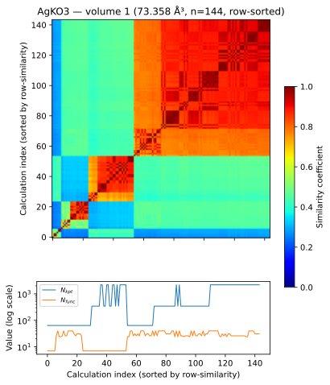

# DOS Convergence Analysis



*Example result (AgKO3): DOS similarity between all 144 calculations, sorted so that groups of converged settings appear as red diagonal blocks. The lower panel shows the k-point count and basis-function count behind each calculation.*

Reproducing and extending the numerical-error / DOS-similarity analysis from:

> Martin Kuban, Santiago Rigamonti, and Claudia Draxl:
> **MADAS: a Python framework for assessing similarity in materials-science data**
> *Digital Discovery* **3**, (2024), 2448–2457

This repository does two things:

1. **Reproduces the original MADAS paper examples** (Figures 1, 4, and 5) — cross-database
   unit-cell volume comparisons (AFLOW, Materials Project, OQMD) and DOS-similarity
   correlation analysis using NOMAD data.
2. **Extends the analysis to a full 161-material production run**, evaluating how Density
   of States (DOS) similarity changes with basis-set size and k-point grid density for the
   `Numerical_Errors_FHI-aims` NOMAD dataset — automating what was previously a
   per-material manual process into a single reproducible pipeline.

## Why this matters

DFT calculations depend on numerical settings (basis-set size, k-point density) that are
rarely converged the same way across databases or codes. This repo uses the `madas`
similarity framework to fingerprint each material's DOS at different numerical settings and
visualize, per material, how quickly (or poorly) it converges to a stable electronic
structure. Materials that fail to converge cleanly show up as visually distinct heatmap
regions rather than requiring a manual, calculation-by-calculation check.

## Repository structure

```
dos-convergence-analysis/
├── ids/                                  # NOMAD/AFLOW/MP/OQMD entry-ID lists per figure
│   ├── Figure1_AFLOW.txt
│   ├── Figure1_MP.txt
│   ├── Figure1_OQMD.txt
│   ├── Figure4_NOMAD.txt
│   ├── Figure5_NOMAD.txt
│   └── database_ids_to_file.py           # Helper: queries databases, writes ID lists
│
├── notebooks/                            # All analysis notebooks
│   ├── comparing_web_databases_volumes.ipynb   # Figure 1: cross-database volume comparison
│   ├── data_quality_assessment.ipynb
│   ├── analyze_similarity_correlations.ipynb   # Figures 4 & 5: DOS-similarity correlations
│   ├── fingerprint_tuning.ipynb
│   ├── plotting_functions.py
│   ├── processing_functions.py
│   ├── settings.mplstyle
│   │
│   ├── 01_reproduce_algao3.ipynb          # Single-material (AlGaO3) workflow validation
│   ├── 02_validation_smoke_test.ipynb     # 5-material smoke test of the full pipeline
│   ├── 03_updated_workflow_smoke_test.ipynb  # Finalized workflow, ready for full run
│   ├── 04_all_materials.ipynb             # Full run over all materials (per-material heatmaps + results table)
│   └── 05_full_run_row_sorted.ipynb       # Full run with volume-split, row-similarity-sorted heatmaps
│
├── results/
│   ├── validation/                       # Smoke-test outputs (5 materials)
│   │   ├── *_DOS_similarity_heatmap.svg
│   │   ├── smoke_test_results.csv
│   │   └── smoke_test_summary.csv
│   │
│   └── full_run/                         # Full 161-material production run
│       ├── heatmaps/                     # One DOS-similarity heatmap per material
│       ├── all_materials_results.csv     # Per-material calc counts + completion flags
│       ├── material_inventory.csv        # Materials discovered vs. available calculations
│       └── RESULTS_TABLE.md              # Color-coded (✅/❌) markdown summary table
│
├── scripts/
│   └── make_readme_table.py              # Regenerates RESULTS_TABLE.md from the results CSV
│
├── requirements.txt
├── LICENSE
├── .gitignore
└── README.md
```

## Quick start

**1. Set up the environment**

```bash
python3 -m venv venv
source venv/bin/activate
pip install -r requirements.txt
```

**2. Set your Materials Project API key** (needed for `comparing_web_databases_volumes.ipynb`)

```bash
export MP_API_KEY=<YOUR_KEY>
```

**3. (Optional) Regenerate the database ID lists**

```bash
python3 ids/database_ids_to_file.py
```

**4. Run the notebooks**

```bash
jupyter notebook
```

- To reproduce the original paper figures, open the notebooks in `notebooks/` directly
  (`comparing_web_databases_volumes.ipynb` for Figure 1, `analyze_similarity_correlations.ipynb`
  for Figures 4 & 5).
- To reproduce the full 161-material DOS-convergence run, start with
  `01_reproduce_algao3.ipynb`, then `02_validation_smoke_test.ipynb`, then
  `03_updated_workflow_smoke_test.ipynb` — each validates progressively more of the pipeline
  before the full run — then `04_all_materials.ipynb`, and finally
  `05_full_run_row_sorted.ipynb` for the row-sorted, volume-split heatmaps.

Alternatively, generate static PDF versions of any notebook:

```bash
jupyter nbconvert --to pdf --execute notebooks/<notebook_name>.ipynb
```

## Results

Full 161-material production run: **148/161 materials fully converged** (13 incomplete).

See the [full results table](results/full_run/RESULTS_TABLE.md) for a per-material
breakdown with ✅/❌ convergence status, or browse the individual heatmaps in
[`results/full_run/heatmaps/`](results/full_run/heatmaps/).

To regenerate the results table after a new run:

```bash
python3 scripts/make_readme_table.py results/full_run/all_materials_results.csv results/full_run/RESULTS_TABLE.md
```

## Data source

FHI-aims numerical-quality dataset, NOMAD Repository:
[https://doi.org/10.17172/NOMAD/2020.07.27-1](https://doi.org/10.17172/NOMAD/2020.07.27-1)

## Citation

If you use this code, please cite the original MADAS paper:

```
Kuban, M., Rigamonti, S., & Draxl, C. (2024).
MADAS: a Python framework for assessing similarity in materials-science data.
Digital Discovery, 3, 2448-2457.
```
